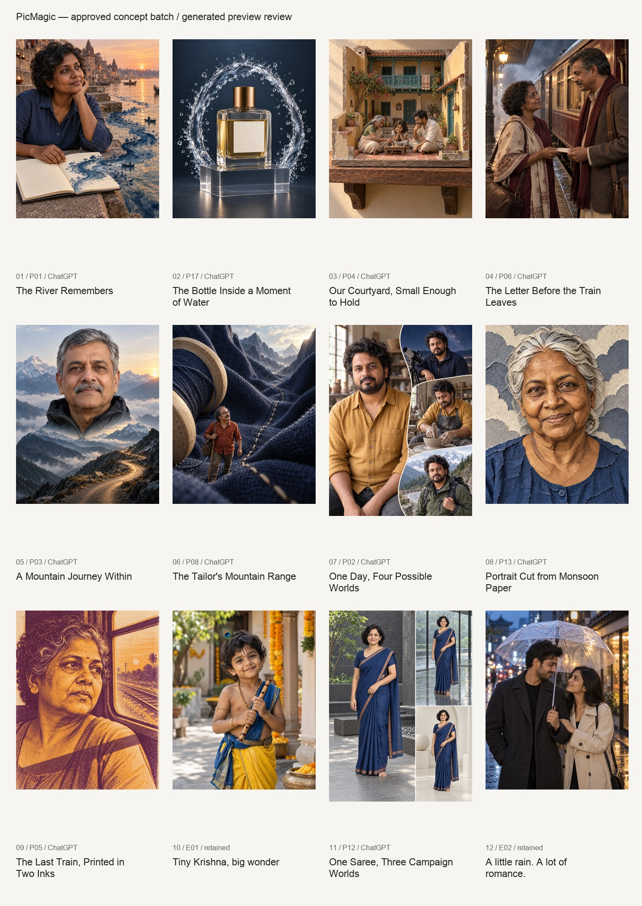

# PicMagic — first creative preview batch

**Status: all 12 approved selections are ready for visual review: 10 new ChatGPT outputs and 2 unchanged reuses. Media is staged locally; no application content was activated and no deployment occurred.**

User approval: “yes, please proceed”, replying to the Phase A question approving this twelve-selection preview batch. The previous research report is preserved. Reserve proposals, previous bulk queues and all new video submissions remain frozen.

## What was produced

- Ten final original images generated through the logged-in ChatGPT browser workflow. No Codex/Astra/API generation or paid external service was used.
- Four fictional reference fixtures (person, product, model/garment and paper-portrait source) plus one controlled identity scene trial were produced for fidelity checks. Total: 15 generated images, of which 10 are final previews.
- Every new human preview brief explicitly requested fictional Indian/South Asian subjects. This is documented generation provenance, not an inference of ethnicity from appearance.
- Exact submitted prompts, conversation URLs, source references, original PNG files, hashes, dimensions, optimized WebP files, alt text and review observations are preserved.
- Twelve copyable prompt texts are staged separately; the correct Krishna and rain-couple texts remain unchanged. Reference identity overrides preview styling; no-reference people default to fictional Indian/South Asian subjects. Paper/ink concepts explicitly translate tonal relationships rather than contradicting their medium with literal photographic skin colour.

## Files

- [Visual overview](contact-sheet.jpg)
- [Complete media manifest and QA](manifest.json)
- [Exact browser-entered generation briefs](submitted-prompts.json)
- [Separate copyable user prompts](copyable-prompts.json)
- [Validation results](validation.json)

## Output inventory

| Selection | Preview | Web dimensions | Size | Reference/QA |
|---|---|---|---:|---|
| P01 · The River Remembers | [Open image](assets/the-river-remembers-creative-v2.webp) | 960 × 1200 | 186 KiB | Original fictional scene |
| P17 · The Bottle Inside a Moment of Water | [Open image](assets/perfume-the-water-sculpture-creative-v2.webp) | 960 × 1200 | 141 KiB | p17-bottle-fixture.png |
| P04 · Our Courtyard, Small Enough to Hold | [Open image](assets/our-courtyard-small-enough-to-hold-creative-v2.webp) | 960 × 1200 | 181 KiB | Original fictional scene |
| P06 · The Letter Before the Train Leaves | [Open image](assets/the-heritage-railway-letter-creative-v2.webp) | 960 × 1200 | 177 KiB | Original fictional scene |
| P03 · A Mountain Journey Within | [Open image](assets/a-mountain-journey-within-creative-v2.webp) | 960 × 1200 | 192 KiB | Original fictional scene |
| P08 · The Tailor's Mountain Range | [Open image](assets/the-tailors-mountain-range-creative-v2.webp) | 960 × 1200 | 170 KiB | Original fictional scene |
| P02 · One Day, Four Possible Worlds | [Open image](assets/one-day-four-possible-worlds-creative-v2.webp) | 1080 × 1440 | 215 KiB | p02-identity-fixture.png + p02-observer-trial.png |
| P13 · Portrait Cut from Monsoon Paper | [Open image](assets/portrait-cut-from-monsoon-paper-creative-v2.webp) | 960 × 1200 | 288 KiB | p13-portrait-fixture.png |
| P05 · The Last Train, Printed in Two Inks | [Open image](assets/last-train-two-ink-portrait-creative-v2.webp) | 960 × 1200 | 524 KiB | Original fictional scene |
| E01 · Tiny Krishna, big wonder | [Open image](assets/tiny-krishna-big-wonder.webp) | 960 × 1200 | 110 KiB | Retained Phase A asset |
| P12 · One Saree, Three Campaign Worlds | [Open image](assets/one-saree-three-campaign-worlds-creative-v2.webp) | 1080 × 1440 | 204 KiB | p12-saree-fixture.png |
| E02 · A little rain. A lot of romance. | [Open image](assets/a-little-rain-a-lot-of-romance-555935eb1d.webp) | 960 × 1200 | 141 KiB | Retained Phase A asset |

## Observed quality and practical limits

- P02: the same fictional face is recognizable in four intentional depictions, following a saved one-scene trial. This is a visual feasibility check, not a guarantee for all future uploaded faces.
- P12: the same model and front garment view remain visually consistent in three settings. No rear view is invented. The fictional example has no seller logo; real labels and fine construction still require source comparison/compositing.
- P13: reference face geometry, smile asymmetry and age cues remain recognizable through paper relief.
- P17: bottle geometry, cap, blank label and liquid level remain visually consistent; water stays behind the dry label. Blank-label success does not prove exact reproduction of commercial lettering.
- P04 and P08: family faces and miniature-person details need wider cards. P02 and P12 must retain uncropped 3:4 layouts; use wider presentation on mobile rather than compressing the panels into tiny columns.
- The two reuses retain the visible Krishna tilak/curls/feather/flute and the two-person umbrella composition. No unnecessary regeneration.

## Optimization and verification

- New final WebP files total **2.22 MiB**, versus **24.92 MiB** for downloaded PNG originals.
- Full web previews are 960 × 1200 for 4:5 and 1080 × 1440 for the two 3:4 compositions. ChatGPT delivered 1122 × 1402 and 1086 × 1448 respectively, below the requested nominal dimensions. Files were downscaled; none was artificially enlarged.
- Thumbnails range from approximately 43 to 109 KiB. The grain-heavy two-ink full image is the largest at about 524 KiB; it should remain lazy-loaded below the fold.
- All ten outputs were individually viewed, including source comparisons where fixtures were used, and the full set was reviewed together.
- **94/94 media/prompt-package checks pass**: approved membership, unique canonical candidates, eight noncolliding new slugs, two existing canonical owners, media dimensions/ratios, source hashes, references, no upscaling, thumbnail limits and unchanged retained copy.
- No fresh application lint, TypeScript, unit/E2E, Lighthouse or production verification was run for this media-only batch. Historical results are not new validation.

## Next local implementation checkpoint

This preview batch is complete. Website integration and the broader production overhaul are not complete. Keep the following separate from media-generation completion:

1. Integrate only the reviewed batch: eight new detail records plus updates to the two existing canonical owners, with these separate user prompts and image briefs. Do not rename existing canonical paths.
2. Apply the proposed transformation/identity contract to schema, validation, admin and generators, including material palettes and identity-versus-depiction counts. The staged prompt text does not yet satisfy the current literal-string persona validator; migrate the validator coherently rather than bypassing it.
3. Add the qualified Creative Transformations collection and homepage ordering, with wide uncropped presentation where indicated. Keep remaining incomplete records draft.
4. Correct the retained Krishna regeneration metadata without rewriting its correct copyable prompt. Continue the other Phase A audit fixes before treating the entire library as release-ready.
5. Run fresh local application checks and manual mobile review, measure production-mode performance, reconcile production content and current hosting allowance, then prepare one coordinated release. There is no production deployment in this batch.

No provider access dependency prevented this image batch. Video remains intentionally deferred. Earlier incomplete library records and deferred assets are still outstanding; this first batch does not erase that backlog.
