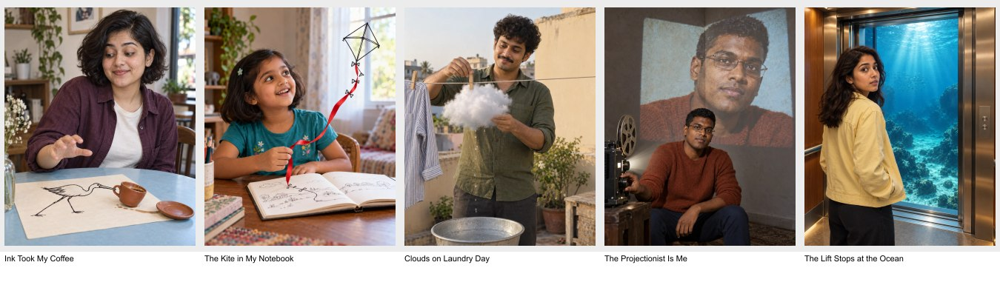

# PicMagic reference-inspired expansion — 15 September 2026

**Local implementation complete; release remains on hold.** Reviewed the current 177-record library and historical queues, evaluated 15 candidates, rejected 10, and integrated five QA-accepted original previews as unpublished local drafts. The resulting local catalogue contains 182 records: 75 marked published and 107 drafts, with 40 existing collections. These local flags are not a fresh verification of production publication.

## Scope and branch safety

Branch: `content/identity-and-collection-audit`. Starting commit: `9000a75`. Main remains `374fe7fe72b80c1c090af50757d418fded7aa651`. Nothing was pushed, merged, deployed, published through admin, or written to production Supabase/Storage. No Netlify build was requested. No PR or release tag was created. All commits for this batch are local and use `[skip netlify]`; this is additional protection, not permission to push. Remote deployment controls have not been reverified for a push, so pushing remains prohibited.

Existing dirty release documents and `next-env.d.ts` were preserved and excluded from the batch commit. The general agent instructions were preserved and a scoped reference/privacy hold was appended. The existing live site was not paused. A billing reset is not release approval.

## Supplied-reference analysis

All six images were visually inspected. They were not uploaded to ChatGPT, copied into public assets, or used as identity references. The local-only comparison sheet is gitignored under `.release-private/`. Provenance, original filenames and SHA-256 values are in [supplied-references.json](supplied-references.json). No identities or ethnicities were inferred from these photographs.

| Reference | Observed mechanism/composition | Original direction / outcome |
|---|---|---|
| R1 | Photographic child runs right while a flat ink figure pulls stretched clothing; toy dinosaur and large negative space. Full-body diagonal movement; physical fabric tension joins two media. | A seated adult and a cup moved by an original ink bird; different action, prop and framing. |
| R2 | Headphone wearer stands on a giant phone displaying branded music UI. High angle, strong foreshortening and familiar object establish scale. | Music made architectural already exists in Listening Room. Exclude another giant player. |
| R3 | Close portrait in dark clothing, sunglasses, cool/warm edge lighting. Face occupies most of portrait; dark uncluttered background. | Use surface detail and separation as quality criteria, not a new generic DP. |
| R4 | Child in yellow running with lollipop while ink character pulls clothing. Same shirt-tension mechanism as R1, different costume and prop. | Consider a separate notebook-origin interaction only if distinct from existing storybook content. |
| R5 | Close portrait with visible eyes and blue/warm edge illumination. Face-first shallow framing and clear expression. | Quality benchmark only; current DP collection already serves this composition. |
| R6 | Large hazy head behind a smaller three-quarter depiction of one identity. Two intentional depictions separated by scale and atmospheric depth. | Explore a live subject operating a projector, with a second depiction visibly carried by architecture. |

R1 and R4 informed **Ink Took My Coffee** and **The Kite in My Notebook** through physical interaction between ink and photographic objects; the shirt-pulling action, running pose, props and cast were not copied. R2’s giant-phone/player direction was rejected: removing a logo would not make the composition original, and a soundwave direction already exists in PicMagic. R3 and R5 informed facial-readability and lighting quality only; proposed DP variants were redundant. R6 informed **The Projectionist Is Me**, replacing atmospheric compositing with a visible projector and architectural wall corner. It is intentionally one identity depicted twice.

## Fresh reference-site research

Six fresh image/full-prompt pairs were inspected across all three sites, with observations separated from interpretation. No popularity or “viral” claims are made. See [research.json](research.json) for exact access states, mechanisms, adaptations and contradictions.

- **CG01** — [https://gpt-image2.canghe.ai/](https://gpt-image2.canghe.ai/); [exact case](https://github.com/freestylefly/awesome-gpt-image-2/blob/main/docs/gallery-part-2.md#case-509)
  Observed: Full-body running child, doodle pulls shirt; dinosaur prop. Full editable prompt explicitly lists dinosaur/lollipop.
  Interpretation: Physical inter-media force. Very close to R1/R4; this is not an independent new idea.
  Limitation: None
- **CG02** — [https://gpt-image2.canghe.ai/](https://gpt-image2.canghe.ai/); [exact case](https://github.com/freestylefly/awesome-gpt-image-2/blob/main/docs/gallery-part-2.md#case-517)
  Observed: Inside-cup fisheye looks through ice and a green straw toward a large face. Full Japanese prompt controls reflections, contact and perspective.
  Interpretation: An everyday object becomes an unusual camera position. Preview has visible decorative lettering despite prompt asking unreadable text.
  Limitation: None
- **YM01** — [https://youmind.com/prompts/mixed-media-illustration-style-34303](https://youmind.com/prompts/mixed-media-illustration-style-34303)
  Observed: Preview is copper/black graphic female portrait with painterly surface and geometric fragments. Full prompt piles many effects and claims 100% matching.
  Interpretation: Material contrast catches attention, but many effects are not a narrative. The matching claim is unsupported.
  Limitation: None
- **YM02** — [https://youmind.com/prompts/matchstick-tiger-sculpture-studio-shot-34305](https://youmind.com/prompts/matchstick-tiger-sculpture-studio-shot-34305)
  Observed: Full translated prompt describes a tiger built from matches. Displayed image is a social-account screenshot/grid with small sculpture thumbnails, not a standalone full tiger.
  Interpretation: Material substitution is legible in thumbnail; high-resolution sculpture quality cannot be assessed from this preview.
  Limitation: Standalone sculpture image unavailable; only account-grid preview visible.
- **AP01** — [https://aiphotoprompt.io/prompts/create-a-nostalgic-editorial-photo-to-sketch-artbook-page-based-on-the-reference-image/](https://aiphotoprompt.io/prompts/create-a-nostalgic-editorial-photo-to-sketch-artbook-page-based-on-the-reference-image/)
  Observed: Before/after slider shows photo above and same scene as ink sketch below with editorial lettering. Full prompt preserves scene and requests two sections.
  Interpretation: Repeated scene across media; readable but close to existing River Remembers and Four Worlds.
  Limitation: None
- **AP02** — [https://aiphotoprompt.io/prompts/manual-1787467623909-17-sdkv5-socks-hanging-on-clothesline-202608231431/](https://aiphotoprompt.io/prompts/manual-1787467623909-17-sdkv5-socks-hanging-on-clothesline-202608231431/)
  Observed: Four white/coral socks on diagonal clothesline against blue sky; full prompt specifies clothespins, folds and hard sunlight.
  Interpretation: Ordinary objects form a clear graphic silhouette. This alone would not justify a PicMagic portrait.
  Limitation: None

The YouMind matchstick entry’s visible preview was a social-account grid, not an isolated tiger; its complete text prompt was inspected, but isolated-sculpture image quality is not claimed. Canghe was inspected through Chrome rather than relying on its text-only response. Source artwork, prompt wording, people, branded interfaces and album covers were not reused.

## Duplicate review and candidate decisions

[Current-library snapshot](current-library.json), [record-level duplicate search](duplicate-analysis.json) and [full candidate records](candidates.json) preserve the evidence. Search covered titles, slugs, descriptions, prompts, image briefs, transformations, tags, collections, local unpublished records and historical queues. Each of 15 candidates has three existing comparisons (45 links); all comparison IDs exist. Twenty-four available nearest images were visually inspected. Five nearest draft assets do not exist locally and are explicitly marked unavailable; their comparisons are textual only.

Scores below are editorial judgments, not measured engagement: D = distinctiveness, N = novelty, S = predicted shareability, M = mobile impact, I = identity feasibility. Accepted rows show final execution scores, including the coffee concept reduced from D5 to D4 after visual review.

| Candidate | D | N | S | M | I | Decision / rationale |
|---|---:|---:|---:|---:|---:|---|
| Ink Took My Coffee | 4 | 4 | 5 | 5 | 4 | Accepted local draft: Physical interaction with a displaced real object replaces decorative shoulder marks and journal-to-landscape transition. Table-level framing and a coffee-stealing ink bird differ from child shirt-tugging. |
| The Kite in My Notebook | 4 | 4 | 4 | 4 | 4 | Accepted local draft: Single child actively interacts with an escaping line drawing; existing family storybook uses passive illustrated background scenery and River Remembers turns landscape into ink. The geometric kite and bookmark give a different narrative from adult coffee theft. |
| Clouds on Laundry Day | 5 | 4 | 5 | 4 | 5 | Accepted local draft: Actual atmospheric cloud treated as laundry, with peg tension and droplets, instead of a painted moon prop, a studio baby cloud mat or a friendship bridge. The person acts on the weather rather than posing beside scenery. |
| The Projectionist Is Me | 4 | 4 | 4 | 4 | 3 | Accepted local draft: Physical projection visibly bends across a wall corner, and the same person operates it. Existing Four Worlds is a multi-scene layout; Mountain Journey uses a landscape inside one silhouette. This is one room with a working optical relationship, not R6’s hazy head behind a standing body. |
| The Lift Stops at the Ocean | 4 | 4 | 4 | 4 | 4 | Accepted local draft: A mundane lift opens onto an impossible sealed underwater destination. It differs from the balcony chai bridge in threshold/reveal/optical enclosure, from rotated stairs in environmental narrative, and from seaside travel in impossible interior-to-ocean depth. |
| Doodle Won’t Let Me Leave | 4 | 2 | 4 | 4 | 4 | Rejected: Changing child to adult repeats supplied and CG01 composition; reject near-copy. |
| Standing Inside My Soundwave | 4 | 1 | 4 | 4 | 5 | Rejected: Direct equivalent already integrated in the preceding round. |
| Walk Through My Playlist | 4 | 3 | 4 | 4 | 4 | Rejected: Removing branding does not materially change the supplied giant-phone composition. |
| Split Light Identity | 3 | 2 | 3 | 4 | 5 | Rejected: Primarily lighting and framing variation; the small-size mechanism disappears. No new DP justified. |
| Blinds Around the Face | 3 | 2 | 3 | 4 | 5 | Rejected: Existing face-safe projected shadows already serve the use. |
| Main Character in Haze | 3 | 2 | 4 | 4 | 3 | Rejected: Repeated depictions alone are already covered; composition is too close to R6. |
| Monsoon Sealed in My Jacket | 4 | 3 | 4 | 3 | 4 | Rejected: Different physical containment from queued monsoon-in-your-jacket, but final silhouette/payoff remains too close and detail may vanish at mobile size. |
| A Matchstick Version of Me | 3 | 2 | 3 | 3 | 2 | Rejected: Material swap repeats existing relief portrait and may erase facial landmarks; too close to the source material recipe. |
| My Weekend in Two Mediums | 3 | 2 | 3 | 3 | 4 | Rejected: Already represented in photo/illustration territory and directly resembles AP01. |
| Inside the Lens Barrel | 4 | 3 | 4 | 3 | 4 | Rejected: New prop but familiar aperture framing. Would lose the equipment narrative inside circular DP crops. |

## Accepted concepts, taxonomy and nearest comparisons

### Ink Took My Coffee

A photographic adult sits at an oval pale-blue table, waist-up, amused and reaching toward an empty saucer. On a cream paper placemat, an original flat black-ink long-legged bird hooks its drawn beak through the handle of a real terracotta cup and drags it away. One curved coffee trail and a small displaced saucer show the physical consequence. The bird remains a flat drawing with no shading; the cup, hand, fabric and person stay photographic. No running, stretched clothing or stick figure.

**Why AI:** Builds a real/ink interaction that cannot be photographed as a normal cafe moment.

**Canonical draft:** `/ai-prompts/women/ink-took-my-coffee`. **Ratio:** 4:5. **Transformation:** `interacting-ink-character`.

**Collections:** creative-transformations. Category `women`. Existing taxonomy only; no new collection or duplicate record.

**Membership rationale:** {'creative-transformations': 'Reference-aware creative transformation with a visible impossible or mixed-media mechanism.'}

**Three nearest existing records:**
- `/ai-prompts/social-media/small-burst-of-motion-profile` — illustrated-shoulder-motion.
- `/ai-prompts/travel/the-river-remembers` — photo-illustration.
- `/ai-prompts/couple/coffee-rain-and-college-days` — None.

**Difference:** Physical interaction with a displaced real object replaces decorative shoulder marks and journal-to-landscape transition. Table-level framing and a coffee-stealing ink bird differ from child shirt-tugging.

**Execution/identity risk:** Cup/beak/handle contact and reaching hand must be coherent.

### The Kite in My Notebook

One child sits securely at a low table beside an open sketchbook. A simple black-ink diamond kite lifts out of the page, still visibly flat hand-drawn ink, its lower tail continuous with a drawn line on the page. The kite catches and raises a real wide red bookmark ribbon from the book. The child holds the other ribbon end gently and looks at the escaped drawing with delight. Child, hands, book and ribbon remain photographic. Show the page-to-air connection and ribbon tension clearly; no flying child, creature face or shirt pulling.

**Why AI:** Makes a child’s drawing physically lift a real bookmark while preserving the child photographically.

**Canonical draft:** `/ai-prompts/kids/the-kite-in-my-notebook`. **Ratio:** 4:5. **Transformation:** `drawing-leaves-page`.

**Collections:** creative-transformations. Category `kids`. Existing taxonomy only; no new collection or duplicate record.

**Membership rationale:** {'creative-transformations': 'Reference-aware creative transformation with a visible impossible or mixed-media mechanism.'}

**Three nearest existing records:**
- `/ai-prompts/family/the-family-s-little-storybook-reader` — None.
- `/ai-prompts/travel/the-river-remembers` — photo-illustration.
- `/ai-prompts/kids/a-tiny-superhero-off-duty` — None.

**Difference:** Single child actively interacts with an escaping line drawing; existing family storybook uses passive illustrated background scenery and River Remembers turns landscape into ink. The geometric kite and bookmark give a different narrative from adult coffee theft.

**Execution/identity risk:** Kite must stay drawn rather than become a paper craft; ribbon must attach without tangled extra fingers.

### Clouds on Laundry Day

A person stands waist-up on a broad safe apartment terrace behind a low laundry line. They attach one wooden clothespin to a small soft volumetric cloud already hanging from the line beside a single ordinary striped cotton shirt. The cloud sags gently at the pegs and sheds a few tiny droplets into a metal basin below; it is condensed mist, not cotton stuffing or a toy. Face and the pinching hand are clear. A quiet warm plaster wall and distant roofline anchor the ordinary Indian home setting. One impossible domestic chore, not many floating clouds.

**Why AI:** Turns a familiar terrace chore into a believable impossible weather interaction without building a special-effects cloud rig.

**Canonical draft:** `/ai-prompts/men/clouds-on-laundry-day`. **Ratio:** 4:5. **Transformation:** `domestic-weather-surrealism`.

**Collections:** creative-transformations. Category `men`. Existing taxonomy only; no new collection or duplicate record.

**Membership rationale:** {'creative-transformations': 'Reference-aware creative transformation with a visible impossible or mixed-media mechanism.'}

**Three nearest existing records:**
- `/ai-prompts/social-media/borrowed-moon-closing-time` — fictional-film-moment.
- `/ai-prompts/social-media/chai-between-the-floors` — impossible-social-location.
- `/ai-prompts/family/first-birthday-cloud-world` — None.

**Difference:** Actual atmospheric cloud treated as laundry, with peg tension and droplets, instead of a painted moon prop, a studio baby cloud mat or a friendship bridge. The person acts on the weather rather than posing beside scenery.

**Execution/identity risk:** Cloud must read as mist with droplets, not a pillow. Keep both hands simple and away from facial landmarks.

### The Projectionist Is Me

One adult sits in the lower centre foreground beside a small film projector, one hand resting on its focus knob. Behind them, a LARGE second close portrait of that same identity is projected onto the corner of two angled plaster walls. The projected portrait bends visibly across the architectural corner; its light has surface grain and a rectangular projector boundary. The foreground person is real and neutrally lit, looking towards camera with the same unmistakable facial geometry. Exactly TWO intentional depictions of ONE identity: one physical person and one projected image. No ghost head, double exposure, collage windows, title or branding. Keep both faces unobstructed and recognizable; no face split across a deep gap.

**Why AI:** Creates a large commissioned self-portrait projection across architecture while keeping the operator and projection as one identity.

**Canonical draft:** `/ai-prompts/men/the-projectionist-is-me`. **Ratio:** 4:5. **Transformation:** `architectural-self-projection`.

**Collections:** creative-transformations, cinematic. Category `men`. Existing taxonomy only; no new collection or duplicate record.

**Membership rationale:** {'creative-transformations': 'Reference-aware creative transformation with a visible impossible or mixed-media mechanism.', 'cinematic': 'Narrative optical scene suitable for fictional-film inspiration.'}

**Three nearest existing records:**
- `/ai-prompts/social-media/one-day-four-possible-worlds` — multi-scene-identity.
- `/ai-prompts/travel/a-mountain-journey-within` — controlled-double-exposure.
- `/ai-prompts/cinematic/a-night-at-the-cinema` — None.

**Difference:** Physical projection visibly bends across a wall corner, and the same person operates it. Existing Four Worlds is a multi-scene layout; Mountain Journey uses a landscape inside one silhouette. This is one room with a working optical relationship, not R6’s hazy head behind a standing body.

**Execution/identity risk:** Highest identity risk: second depiction may drift. Projector beam, wall corner and scale must stay clear; reject if it becomes a generic double exposure.

### The Lift Stops at the Ocean

A person stands three-quarter-length inside a compact warm wood-and-brushed-metal lift, turned gently back toward the camera. Behind them the open inner lift doors reveal an intact clear outer observation wall and an immense underwater ocean beyond. Sunbeams descend through clear turquoise water; one small distant shoal establishes depth. The lift floor and person are completely dry. The clear sealed outer pane has a visible continuous frame so the ocean is convincingly outside. No water pouring in, giant fish, labels, controls with text or recognizable building. The person fills about half the frame height; this is an impossible elevator destination, not an aquarium selfie.

**Why AI:** Creates a dry everyday lift suspended beside an ocean view that would require a major underwater set or compositing.

**Canonical draft:** `/ai-prompts/women/the-lift-stops-at-the-ocean`. **Ratio:** 4:5. **Transformation:** `impossible-everyday-threshold`.

**Collections:** creative-transformations, cinematic. Category `women`. Existing taxonomy only; no new collection or duplicate record.

**Membership rationale:** {'creative-transformations': 'Reference-aware creative transformation with a visible impossible or mixed-media mechanism.', 'cinematic': 'Narrative optical scene suitable for fictional-film inspiration.'}

**Three nearest existing records:**
- `/ai-prompts/social-media/chai-between-the-floors` — impossible-social-location.
- `/ai-prompts/social-media/between-two-gravities` — impossible-spatial-set.
- `/reel-prompts/reels/from-suitcase-to-seaside` — None.

**Difference:** A mundane lift opens onto an impossible sealed underwater destination. It differs from the balcony chai bridge in threshold/reveal/optical enclosure, from rotated stairs in environmental narrative, and from seaside travel in impossible interior-to-ocean depth.

**Execution/identity risk:** Water may flood cabin or become a flat screen. Require an obvious dry interior, framed clear pane and visible ocean depth.

## Complete prompts and identity separation

[PRODUCTION-PROMPTS.md](PRODUCTION-PROMPTS.md) contains all five complete copyable user prompts and separate fictional preview prompts. [generation-manifest.json](generation-manifest.json) contains the exact first prompts, focused correction prompts, consolidated regeneration prompts, provider, conversation URLs, source filenames, dimensions, provenance, hashes, alt text and QA status.

The uploaded user/person is authoritative for recognizable face, facial geometry, apparent age, ethnicity, natural complexion, hairline, distinguishing marks, meaningful glasses/facial hair and proportions. Styling, pose, expression, wardrobe and concept-appropriate hair arrangement may change. Reference users never inherit fictional Gen Z age, fairness, face or build. No-reference mode requests an appropriate fictional Indian/South Asian person. Kids requires a child reference and never de-ages an adult. Projection explicitly allows two intentional depictions of one identity; it does not accidentally ban its own projected face. The photographic face remains photographic while nonhuman ink elements use their declared medium. Prompt review found no palette or age conflicts.

No real user reference was submitted to test facial transfer. Text constraints and the fictional projection’s visual consistency were checked; guaranteed identity preservation is not claimed.

## Generated assets and QA

All images were generated in the user’s logged-in ChatGPT browser workflow: five initial attempts plus three diagnosed corrections, eight images total. No Codex/Astra image generation, paid API, subscription purchase or extra-credit purchase was used. Existing account generation allowance was used; its monetary value/remaining quota was not measured.

| Accepted image | Source | Optimized master | QA |
|---|---|---|
| ink-took-my-coffee | `media/sources/ink-took-my-coffee-v1.png` | `/previews/ink-took-my-coffee-impact.webp`; 1080×1350 WebP, 126,916 bytes | Accepted first attempt: flat ink bird visibly hooks real cup handle; coffee trail and displaced saucer establish consequence. Face, natural texture and ordinary hand anatomy are clear. Composition is materially different from supplied shirt-pulling references. |
| the-kite-in-my-notebook | `media/sources/the-kite-in-my-notebook-v2.png` | `/previews/the-kite-in-my-notebook-impact.webp`; 1080×1350 WebP, 115,900 bytes | Accepted after one focused correction: transparent kite interior now reveals window, clearly separating ink line from paper craft. Ribbon connects page and kite, child seated securely, face and hands readable. No supplied child identity was used. |
| clouds-on-laundry-day | `media/sources/clouds-on-laundry-day-v1.png` | `/previews/clouds-on-laundry-day-impact.webp`; 1080×1350 WebP, 132,522 bytes | Accepted first attempt: cloud has mist edges and distinct falling droplets, clothespin and basin make the impossible chore legible. Face and pinching hand are natural. Not a cotton pillow or painted moon prop. |
| the-projectionist-is-me | `media/sources/the-projectionist-is-me-v2.png` | `/previews/the-projectionist-is-me-impact.webp`; 1080×1350 WebP, 117,392 bytes | Accepted after removing incidental framed artwork: exactly one physical man plus his recognizable projected self. Projection has plaster texture, rectangular light boundary and visible wall corner; glasses and facial geometry align. Reference-transfer performance with a real user remains untested. |
| the-lift-stops-at-the-ocean | `media/sources/the-lift-stops-at-the-ocean-v2.png` | `/previews/the-lift-stops-at-the-ocean-impact.webp`; 1080×1350 WebP, 144,066 bytes | Accepted after one clarification: sliding leaves, door track, threshold and unlabelled panel make lift legible; dry enclosure and ocean depth remain coherent. Face more prominent. Lowest priority of accepted five; do not automatically feature on homepage. |

Each master has a 480×600 WebP thumbnail. Existing responsive image delivery and reserved geometry are reused. Public files total five masters and five thumbnails; rejected first attempts remain research-only, not public previews. All five are 4:5 feed compositions. **No DP concept survived novelty review**, so no new 1:1 asset or circular-crop result is claimed. Existing DP content was left unchanged.

[Accepted contact sheet](media/accepted-contact-sheet.jpg) · [New versus existing comparisons](media/new-vs-existing.jpg) · [Nearest existing assets](media/nearest-existing.jpg).

The supplied-reference/new-preview comparison was visually reviewed locally at `.release-private/reference-impact-2026-09-15/references-vs-new.jpg`. It contains clearly separated RESEARCH REFERENCE and NEW PICMAGIC rows and must never be published or committed. No recognizable supplied face, exact pose/wardrobe/prop combination, or third-party player UI was retained in the new imagery. Comparison against existing previews passed editorial review. The lift is the lowest-priority accepted concept; the projection has the highest reference-transfer risk. The two ink concepts differ in audience, composition and physical narrative, rather than merely changing age or gender.

## Local verification

| Check | Result | Evidence |
|---|---|---|
| Lint | Passed | `verification/lint.log` |
| TypeScript | Passed | `verification/typecheck.log` |
| Unit/component tests | 131 passed across 22 files | `verification/unit.log` |
| Content/schema validation | Passed: 182 records; 107 drafts excluded from publication checks; no missing published images | `verification/content-direct.log` |
| Production build, locally | Passed with standard Next.js Turbopack build; 136 static pages generated | `verification/build-clean.log` |
| Browser tests | 44 passed: 30 existing public journeys plus 14 new desktop/mobile checks | `verification/e2e-final.log` |
| Accessibility | No axe violations on the five new detail pages; existing homepage/detail checks also passed | E2E log |
| Responsive visual QA | 375px, 430px and 1440px; images decoded and no horizontal overflow | `media/qa/` screenshots |
| Main/homepage/sitemap isolation | New flags remain draft/unfeatured/noindex; no new rendered homepage feature links or sitemap URLs; hosted preview guard tested | Unit and E2E tests |

The first `pnpm check:content` invocation hit sandbox IPC EPERM; the same script passed using `node --import tsx scripts/check-content.ts`. The first two production-build attempts hit a sandbox worker-port error. After moving only this task’s generated build output to a private backup, a clean build with local process permissions passed. No app build workaround or production deployment was needed. The initial E2E run had 42 passes and two incorrectly scoped assertions against serialized local-history catalogue data. The assertion now checks rendered homepage feature links; the final 44-test run passes. A final lint rerun initially included generated JavaScript from the failed-build backup; moving that task-owned backup outside the repository restored the normal lint scope, without changing lint rules. These initial failures remain in their logs for traceability.

Browser journeys verify full Copy Prompt text, Save/unsave persistence, Share URL, canonical ownership, local noindex, collection routing, sitemap exclusion, search, creator/enhancement, admin protection, image failure behavior and existing pagination/lazy-load behavior. Manual review covered the desktop page and saved responsive screenshots including the child, coffee and projection concepts. All five final images were inspected full-size and on contact sheets. No Lighthouse run or numerical performance score is claimed for this batch; image sizes and browser behavior were verified. Historical results elsewhere in the repository are not counted as this round’s tests.

## Changed-file inventory

- `content/additions/reference-impact-prompts.json`: five full unpublished records, prompts, preview briefs, SEO and editorial metadata.
- `content/additions/reference-impact-memberships.json`: links to existing collections.
- `content/catalog.ts`: appends the five records; baseline 177 unchanged.
- `lib/prompts/social-preview.ts`: adds these IDs/memberships to the existing explicit seed/local/noindex preview guard.
- `public/previews/*-impact.webp` and `*-impact-thumb.webp`: five accepted masters and five thumbnails.
- `tests/unit/reference-impact.test.ts`, `tests/unit/editorial-quality.test.tsx`, `tests/e2e/reference-impact.spec.ts`: provenance, baseline preservation, persona, taxonomy, release isolation and browser regression coverage.
- `AGENTS.md`: scoped reference/privacy and release-hold guidance.
- This dated audit directory: research, proposals, prompts, media provenance, contact sheets, screenshots and current verification logs.

No route rename, canonical migration, database migration, homepage reorder or production activation occurred. Related content uses existing ranking; nearest related records are documented per candidate. Public routes remain gated until later explicit activation.

## Recommendations, limits and future release checkpoint

For a later homepage review, **Clouds on Laundry Day** is the strongest new candidate, followed by **Ink Took My Coffee**. Compare them with the then-current weakest featured image before any swap. No homepage replacement is authorized or implemented here. Do not feature the lift merely to fill a slot.

Remaining limits: five unavailable nearest draft images could only be compared textually; real-user identity-transfer quality remains tool-dependent; no new DP/circle test is applicable; no Lighthouse score was measured. All five selected media assets are complete, and no external generation dependency blocks local review. Video remains out of scope.

Before any future release: obtain explicit owner approval; verify the current hosting allowance and branch/PR deployment controls; review the five drafts and final preview assets; activate only approved records/memberships; rerun the applicable local checks against the actual release environment; verify rollback; then perform the owner-authorized consolidated release. Do not schedule a release based on a billing reset. Preserve the supplied-reference comparison as private local research.

Local review starts at http://localhost:3005/ai-prompts/women/ink-took-my-coffee. The local server is left running. See `verification/branch-status.json` for the committed snapshot; no remote push is permitted by that record.
